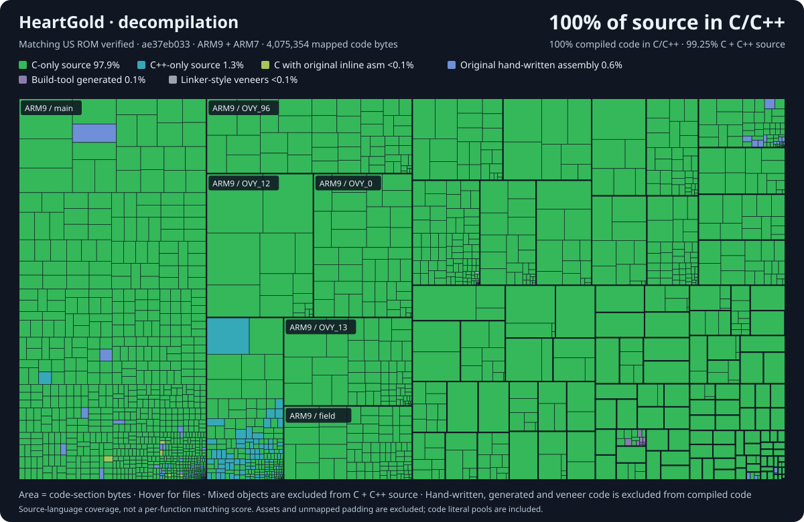

# Pokémon HeartGold and SoulSilver

Independent project. Keep issues and contributions in this repository.

Fully decompiled: everything's C/C++ and both ROMs build byte-for-byte. Built with LLM agents.

Setup is in [INSTALL.md](INSTALL.md).

This repository builds the following ROMs:

* **pokeheartgold.us.nds** `sha1: 4fcded0e2713dc03929845de631d0932ea2b5a37`
* **pokesoulsilver.us.nds** `sha1: f8dc38ea20c17541a43b58c5e6d18c1732c7e582`
